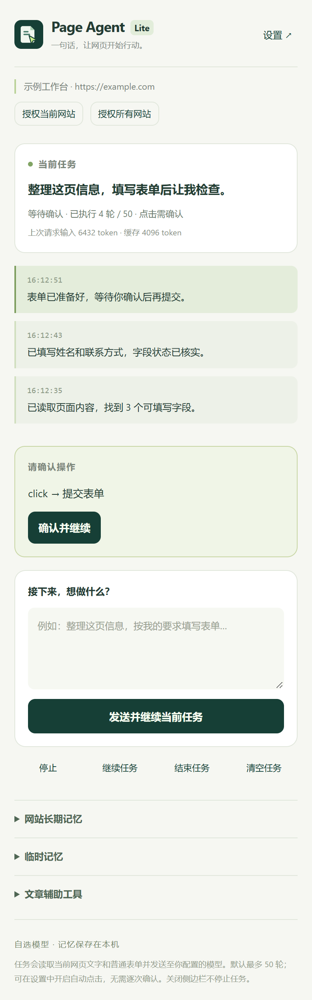

<div align="center">
  
  <h1>Page Agent Lite</h1>
  <p><strong>一句话，让网页开始行动。</strong></p>
  <p>AI驱动的轻量浏览器插件，能持续自动化帮你处理浏览器事物</p>
  <p>
    <a href="LICENSE"></a>
    
    
  </p>
  <p><a href="#快速开始">快速开始</a> · <a href="docs/usage.md">使用指南</a> · <a href="ROADMAP.md">Roadmap</a> · <a href="CONTRIBUTING.md">参与贡献</a></p>
</div>

---

在浏览器侧栏说出目标，助手读取网页、填写表单、点击和翻页，再检查实际结果。使用你现有的登录状态和自己的模型 API，无需 Python、独立后端或构建步骤。

> 项目关注原生扩展、任务恢复、结果核对与本机网站记忆。目前处于早期，请按真实页面反馈核对操作结果。

<div align="center"></div>

<sub>预览使用合成示例数据展示界面，不代表真实模型执行结果。</sub>

## 能做什么

| 能力 | 当前实现 |
| --- | --- |
| 自然语言操作 | 读取顶层 DOM，填写、勾选、选择、点击及窗口/容器四向滚动 |
| 持续任务 | 同站翻页继续，中途补充指令，停止与手动结束分开 |
| 结果核对 | 等待网页反馈、核对字段和区域条件；结果不明时避免重放操作 |
| 网站记忆 | IndexedDB 本机保存，跨任务/标签页/重启共享，按需读取，可编辑和导出 |
| 长任务上下文 | 按预算压缩旧过程，保存摘要和可按需读取的原始结果 |
| 自选模型 | 非流式 OpenAI Chat Completions 兼容接口，支持本机兼容服务 |
| 执行控制 | 填写与点击自动执行，无独立开关；默认 50 轮，0 表示不限 |

## 快速开始

1. 克隆本仓库，或下载源码并解压。
2. 打开 `chrome://extensions` 或 `edge://extensions`，开启开发者模式。
3. 点击「加载已解压的扩展程序」，选择仓库中的 **extension/** 文件夹。
4. 打开扩展「设置」，填写 API 基础地址、模型名称和密钥，选择思考强度（默认中），授权并保存。

   思考强度支持低、中、高及服务默认，通过 `reasoning_effort` 发送；不支持该参数的兼容接口请选择服务默认。显式思考模式不发送 temperature 或输出 token 上限，由服务决定输出预算；可能增加耗时与费用，仍受现有 25 秒请求超时限制。
5. 回到普通网页，点击工具栏图标打开侧栏，在侧栏选择「授权当前网站」或「授权全部网页」，然后输入目标。

```text
读取这页内容，帮我整理成几个要点。
按我提供的信息填写表单，提交前让我检查。
逐页查看这些条目，找出符合条件的内容。
记住这个网站经过核实的操作流程，下次按需参考。
```

模型需要支持可靠的 JSON 输出。浏览器最低版本声明为 120，另需支持 local 存储访问隔离 API；推荐使用新版 Chrome / Edge。更新源码后重新加载扩展并刷新网页。当前提供源码，不发布 ZIP 或浏览器商店安装包。

模型上下文窗口默认 100,000 token，可按实际模型调整；已有自定义窗口保留。自动执行包括提交、删除等页面按钮，可随时停止，已发出的操作不会自动撤销。独立文章工具已退出当前界面，旧文章记录保留。

## 你的数据去哪了

- 目标、页面文字和普通表单内容会发送到你配置的模型服务，API 费用与服务商数据政策由该服务决定。
- API 密钥仅由扩展后台使用；配置存在本机，网站长期笔记存在扩展 IndexedDB。没有遥测或项目自己的云端。
- 任务与临时记忆保存在浏览器会话中；网站长期笔记可跨重启保留。卸载或清理扩展数据可能删除笔记，请导出备份。
- 同一网站的不同登录账号共用网站笔记；不支持自动区分账号。不会自动保存整段对话为长期记忆。

详细说明见 [隐私说明](PRIVACY.md) 和 [使用指南](docs/usage.md)。

## 边界

支持顶层文字 DOM，不支持图片/画布、iframe、Shadow DOM、富文本、多标签页协作或跨站任务。页面读取有容量上限；控件和区域在弹窗优先后按当前视口排序，滚动后重新读取可发现后续控件，但尚不支持全文分区分页。点击前检查遮挡并派发常用 pointer/mouse 事件，仍无法模拟受信任的真实鼠标。填写核对不代表业务正确或服务器保存成功。模型可能误判，也可能遗漏需要确认的操作。

这是可运行的探索项目，不等于完整 Hermes Agent。近期重点与验证状态见 [Roadmap](ROADMAP.md)，不要仅凭功能清单推断所有网站都可稳定执行。

## 开发与贡献

运行扩展不需要安装依赖。仅开发测试需要 Node.js 22+：

```sh
npm ci --ignore-scripts --no-audit --no-fund
npm test
```

- [贡献指南](CONTRIBUTING.md) · [安全问题](SECURITY.md)
- [架构](docs/architecture.md) · [运行器](docs/agent-runtime.md) · [网页工具](docs/browser-tools.md)
- [上下文与记忆](docs/context-and-skills.md) · [存储](docs/storage.md) · [测试](docs/testing.md)
- [Changelog](changelog/README.md) · [同类项目](docs/competitive-landscape.md)

## 许可与参考

采用 [MIT License](LICENSE)。欢迎使用、修改和贡献，请保留许可证与版权声明。

运行器与上下文设计参考了 [Hermes Agent](https://github.com/NousResearch/hermes-agent) 的公开文档。项目采用独立设计的界面与图标。

设置页与侧边栏采用统一浅色界面，白底、浅灰卡片和细边框，蓝色突出主要操作；支持系统「减少动态效果」偏好。侧栏新对话显示蓝色小助手 SVG 插画与简短引导，输入目标即可开始。设置页可通过分类导航快速定位模型、执行预算和记忆管理。

侧边栏以对话为主：顶部显示当前网站，消息按时间排列，工具调用显示为可展开的卡片，可查看请求参数、返回结果与执行状态；底部固定输入框与当前进度。填写期间可补充指令或停止；Enter 发送、Shift + Enter 换行。顶部保留「历史记录」「新对话」「设置」，不重复展示浏览器已有的品牌标题；「新对话」位于顶部历史记录旁，点击后结束旧任务并返回空白输入状态。历史记录按对话列出标题、更新时间和状态，点击只读查看该对话保留的消息、工具结果与摘要；新任务会归档旧对话，不混入新任务的模型上下文。历史仅限当前标签页、当前网站和本次浏览器会话，关闭标签页或浏览器后不保留；更新前已被替换的旧记录无法恢复。查看当前对话时可清空当前记录，其他历史保留。点击「设置」管理模型、默认行为、全站授权、长期/临时记忆；在「网站与记忆管理」选择已打开的目标网页。记忆修改或清空会暂停相关任务，返回侧栏继续。

操作时页面会显示蓝色虚拟指针、目标边框和点击圆环；反馈约 900 毫秒后隐藏，停止、任务结束、滚动、窗口尺寸变化或切换页面时清理。动画与实际操作并行，不会等待动画结束再点击，也不会移动系统鼠标。支持按当前元素 ID 执行合成事件悬停（hover），随后重新读取页面；不能保证触发纯 CSS `:hover` 或需要受信任输入的控件。指针和高亮在本机渲染，不增加模型请求或页面快照内容；hover 工具说明会少量增加提示词 token，实际使用 hover 的记录及后续观察可能增加 token/轮数。更新后重新加载扩展并刷新目标网页。

普通导航和操作方式由助手自主决定；模型因普通阻碍请求暂停时，运行器最多追加三次重新规划，仍受总轮数、权限、无进展及副作用保护限制。缺少必要用户信息或明确要求暂停时立即暂停。重要操作在侧栏显示提示并自动执行，不逐次要求确认；识别采用模型提示和按钮名称启发式，可能遗漏。需要你作多项选择时，侧栏显示复选框，勾选后点击「提交选择并继续」；提交只传回选择内容，重新读取页面后规划，不直接执行旧网页动作。未增加额外请求延迟。
